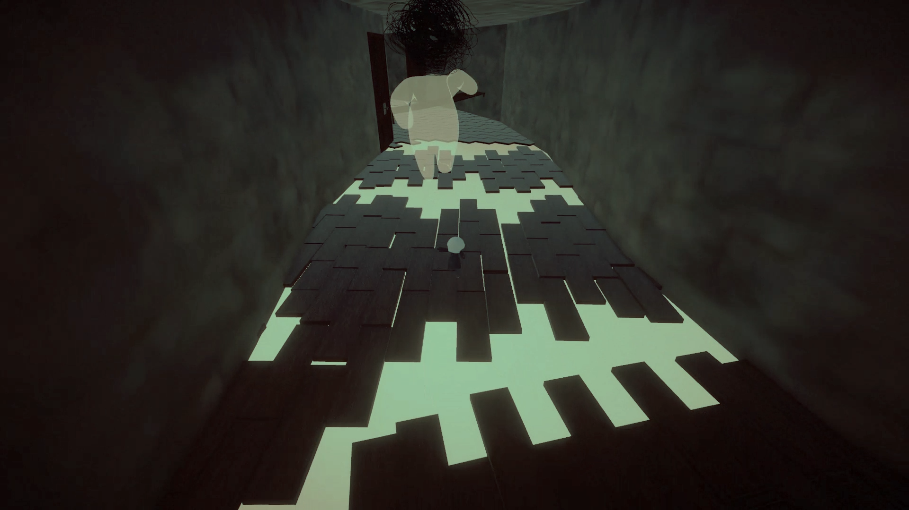
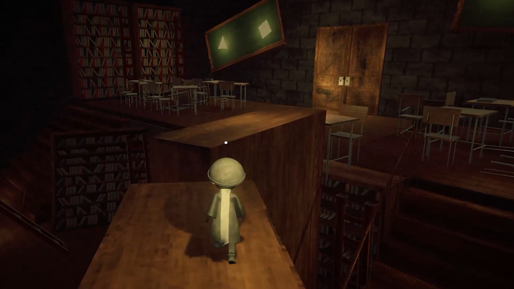
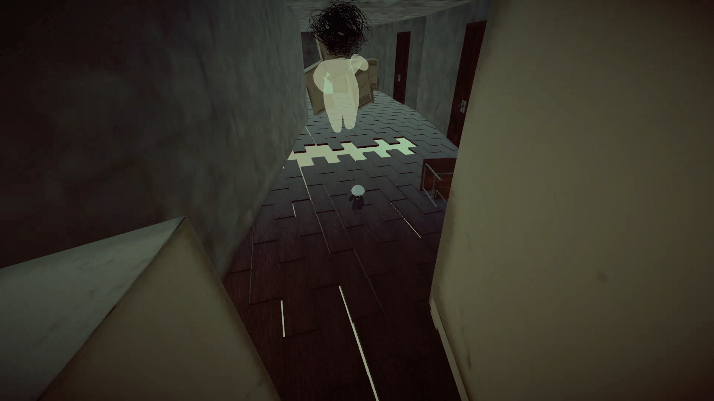

# Apeirophobia

A dark-themed 3D puzzle platformer built in Unity. Explore fractured memories and symbolic spaces inside the mind of a child undergoing hypnosis. This team end-of-studies project combines atmosphere, exploration, stealth and surreal storytelling.

[Download on itch.io](https://kuruttakao.itch.io/apeirophobia) · [Portfolio case study](https://haithem-portfolio.vercel.app/projects/apeirophobia/)

## My contribution

I worked on game design and gameplay programming in a three-person academic team.

- Designed and built **the third level in full**, and maintained parts of the other levels.
- Implemented player movement and interactions, including buffered jumps, coyote time and variable jump height.
- Developed patrol, chase and search AI, enemy field-of-view feedback and boss chase behavior.
- Iterated on encounters, playtesting and gameplay fixes.

This is shared team work, not a solo game. Art, audio and other project systems include contributions from teammates and asset creators.

## About the game

Navigate dream-like environments filled with puzzles, platforming challenges and abstract representations of fear. The mood leans into psychological tension rather than jump scares, using lighting, space and sound to convey unease. Themes include trauma and recovery, memory and perception, and navigating fear through symbolism.

### Gameplay

- 3D platforming and environmental puzzles.
- Stealth encounters with readable enemy awareness.
- Narrative symbolism and surreal level transitions.
- A boss chase combining traversal and pursuit.

## Design and implementation

**Forgiving movement:** input buffering, coyote time and variable jump height help the controller respond to player intent.

**Readable detection:** a raycast-based dynamic mesh visualizes enemy field of view. The raycast count does not automatically adapt to hardware performance.

**Level ownership:** I built level three and contributed maintenance elsewhere; the whole game was developed collaboratively.

## Trailer

## Open the Unity project

1. Clone this repository.
2. Install **Unity 2022.3.18f1**, the version recorded in `ProjectSettings/ProjectVersion.txt`.
3. Add the repository root in Unity Hub and allow packages and assets to import.
4. Check the scenes listed in Build Settings when exploring the project. For the playable version, use the itch.io download above.

`Assets/` contains the game content and scripts, `Packages/` records package dependencies, and `ProjectSettings/` contains the Unity project configuration. Preserve asset `.meta` files when moving or editing project content.

## Status and next steps

This repository preserves the academic project. A fresh build has not been validated as part of this documentation update. Areas I would revisit include earlier performance profiling and more systematic testing of AI transitions and movement edge cases.

## Screenshots

## Credits and license

The student team combined game design, Unity development, 3D art, sound and narrative work. See the repository contributors and in-project credits for attribution. The repository includes an MIT license; third-party assets may have their own terms.
